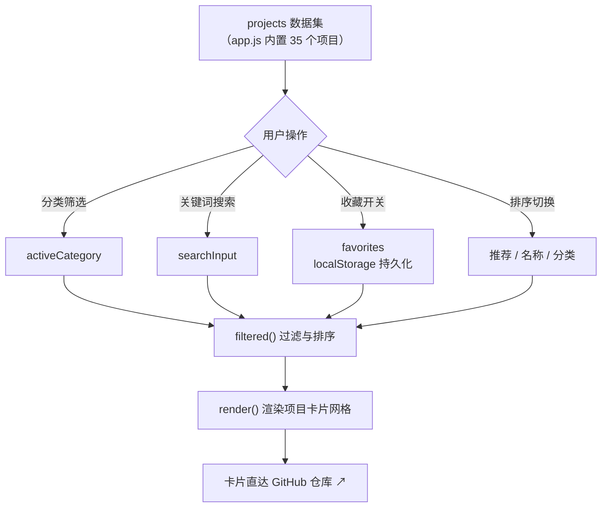

<div align="center">

# AI Open Source Radar

**面向中文 AI 开发者的高质量开源项目雷达 —— 35 个精选项目 × 6 大技术方向，可搜索、可收藏、一键直达**

[](https://jinghao-leon.github.io/ai-oss-radar/)
[](https://github.com/JingHao-Leon/ai-oss-radar)
[](https://github.com/JingHao-Leon/ai-oss-radar/commits/main)
[](https://github.com/JingHao-Leon/ai-oss-radar)
[](LICENSE)

[](https://jinghao-leon.github.io/ai-oss-radar/)

</div>

---

不是又一份链接清单。AI Open Source Radar 是一个纯静态、零依赖的单页站点：按**技术方向、上手路径与适用场景**持续收录真正有生命力的 AI 开源项目，覆盖**具身智能 / 计算机视觉 / 大模型与 NLP / 多模态 / AI Agent / 开发评估与 LLMOps** 六大方向，每个项目都标注了「为什么值得看」并可直接跳转到其 GitHub 仓库。

## ✨ 站点亮点

<table>
<tr>
<td width="33%">

### 🔍 即搜即得
全量项目本地渲染，搜索框实时匹配项目名、组织、分类、标签与简介，零后端零请求。

</td>
<td width="33%">

### 🧭 六大方向筛选
具身智能、计算机视觉、大模型 / NLP、多模态、Agent、开发工具——按你当下的探索方向一键过滤。

</td>
<td width="33%">

### ⭐ 本地收藏夹
收藏写入 `localStorage`，刷新不丢；配合「只看收藏」开关，把雷达变成你的个人学习清单。

</td>
</tr>
<tr>
<td width="33%">

### 🃏 卡片式信息密度
每张卡片给出分类、一句话定位、技术标签和「为什么值得看」，快速判断要不要深入。

</td>
<td width="33%">

### 🎲 随机探索
「给我一个项目」按钮随机抽一个项目并自动滚动定位——不知道看什么时的启动器。

</td>
<td width="33%">

### 🪶 纯静态零构建
一个 `index.html` + 一个 `app.js` + 一份 `styles.css`，推送 `main` 即由 GitHub Pages 发布。

</td>
</tr>
</table>

## 🔄 工作原理



## 🚀 快速上手

无需安装任何依赖，纯静态站点：

```bash
git clone https://github.com/JingHao-Leon/ai-oss-radar.git
cd ai-oss-radar
open index.html          # macOS 直接用浏览器打开
# 或者起一个本地服务：
python3 -m http.server 8000   # 访问 http://localhost:8000
```

线上版本无需任何操作：[jinghao-leon.github.io/ai-oss-radar](https://jinghao-leon.github.io/ai-oss-radar/)。

## 📁 仓库结构

```
├── index.html      # 页面骨架：Hero、项目雷达区、使用指南
├── app.js          # 项目数据集（35 个项目）+ 筛选/搜索/收藏/排序/随机逻辑
├── styles.css      # 全部样式（深色雷达风格）
├── LICENSE         # MIT
└── README.md
```

数据即代码：所有项目信息以结构化数组形式内置在 `app.js` 顶部的 `projects` 中，新增一个项目只需往数组里加一条记录（名称、组织、分类、标签、简介、推荐理由），无需改动任何渲染逻辑。

## 📚 收录项目速览

<details>
<summary><strong>展开查看全部 35 个收录项目（按方向分组）</strong></summary>

### 具身智能

- [LeRobot](https://github.com/huggingface/lerobot) — 机器人数据采集、训练与部署工具链。
- [OpenVLA](https://github.com/openvla/openvla) — 开源视觉-语言-动作机器人模型。
- [Isaac Lab](https://github.com/isaac-sim/IsaacLab) — NVIDIA 机器人学习与仿真框架。
- [ManiSkill](https://github.com/haosulab/ManiSkill) — 高性能机器人操控仿真与基准。
- [Diffusion Policy](https://github.com/real-stanford/diffusion_policy) — 基于扩散模型的视觉运动控制策略。
- [OpenPI](https://github.com/Physical-Intelligence/openpi) — Physical Intelligence 的机器人基础模型。

### 计算机视觉

- [Ultralytics](https://github.com/ultralytics/ultralytics) — YOLO 目标检测、分割、姿态估计与部署。
- [Segment Anything](https://github.com/facebookresearch/segment-anything) — 通用图像分割模型 SAM。
- [MMDetection](https://github.com/open-mmlab/mmdetection) — 模块化目标检测工具箱。
- [PaddleOCR](https://github.com/PaddlePaddle/PaddleOCR) — 多语言 OCR 与文档解析。
- [Detectron2](https://github.com/facebookresearch/detectron2) — 现代视觉识别库。
- [ComfyUI](https://github.com/Comfy-Org/ComfyUI) — 节点式生成图像工作流。

### 大模型与 NLP

- [Transformers](https://github.com/huggingface/transformers) — 预训练模型的核心生态工具库。
- [vLLM](https://github.com/vllm-project/vllm) — 高吞吐 LLM 推理和服务引擎。
- [llama.cpp](https://github.com/ggml-org/llama.cpp) — 消费级硬件运行量化 LLM。
- [Qwen](https://github.com/QwenLM/Qwen) — 通义千问开源模型与工具。
- [OpenAI Cookbook](https://github.com/openai/openai-cookbook) — OpenAI API 官方示例与实践。
- [PEFT](https://github.com/huggingface/peft) — LoRA 等参数高效微调工具库。
- [Axolotl](https://github.com/axolotl-ai-cloud/axolotl) — LLM 微调训练工具。

### 多模态

- [LLaVA](https://github.com/haotian-liu/LLaVA) — 视觉指令微调与图文对话。
- [InternVL](https://github.com/OpenGVLab/InternVL) — 视觉语言模型系列。

### AI Agent 与应用编排

- [MCP](https://github.com/modelcontextprotocol) — 模型连接工具与数据源的开放协议生态。
- [OpenAI Agents SDK](https://github.com/openai/openai-agents-python) — 构建 Agent、工具调用和可观测性。
- [AutoGen](https://github.com/microsoft/autogen) — 多智能体协作框架。
- [Dify](https://github.com/langgenius/dify) — 可视化 LLM 应用开发平台。
- [LangChain](https://github.com/langchain-ai/langchain) — LLM 应用编排框架。
- [LlamaIndex](https://github.com/run-llama/llama_index) — 数据驱动的 RAG 与 Agent 框架。
- [Flowise](https://github.com/FlowiseAI/Flowise) — 拖拽式 LLM 工作流工具。

### 开发、评估与 LLMOps

- [DSPy](https://github.com/stanfordnlp/dspy) — 声明式编程与自动提示优化。
- [LiteLLM](https://github.com/BerriAI/litellm) — 统一的多模型调用网关。
- [Langfuse](https://github.com/langfuse/langfuse) — LLM 可观测性和评估平台。
- [lm-evaluation-harness](https://github.com/EleutherAI/lm-evaluation-harness) — 语言模型评测框架。
- [Ragas](https://github.com/explodinggradients/ragas) — RAG 应用质量评测。
- [Datasets](https://github.com/huggingface/datasets) — 高效处理与共享机器学习数据集。

</details>

## 🤝 参与维护

欢迎通过 [Issue](https://github.com/JingHao-Leon/ai-oss-radar/issues/new) 推荐项目或修正信息。收录优先考虑技术价值、文档质量、社区活跃度与实际可用性。

## 📌 收录口径与局限

- 收录为主编精选（当前 35 个），不是全量榜单，也不追求实时反映 star 数变化。
- 项目简介与「为什么值得看」为编者视角的定性判断，仅供选型参考。
- 站点不抓 GitHub API，收藏等状态仅存于浏览器本地。

## 许可

[MIT](LICENSE)

---

<div align="center">
<sub>
为中文 AI 开发者整理的开源项目雷达 ｜ 在线访问：<a href="https://jinghao-leon.github.io/ai-oss-radar/">jinghao-leon.github.io/ai-oss-radar</a><br>
持续收录中 · 欢迎通过 <a href="https://github.com/JingHao-Leon/ai-oss-radar/issues/new">Issue</a> 推荐项目
</sub>
</div>
